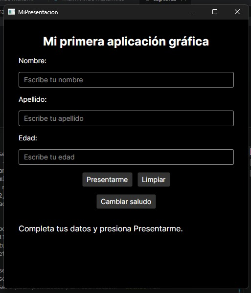
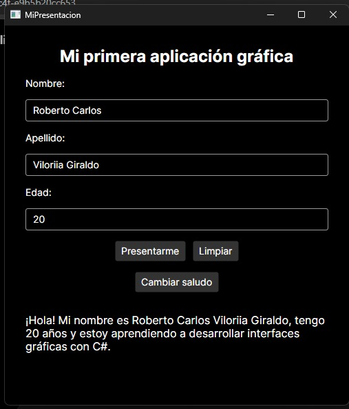
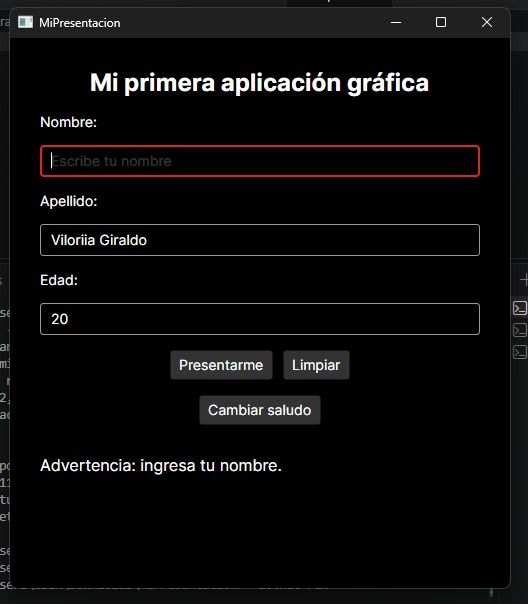

# MiPresentacion

Aplicación de escritorio de presentación personal desarrollada en C# con Avalonia UI 11. Permite ingresar nombre, apellido y edad, validar esos datos y mostrar una presentación con un saludo que se puede cambiar.

## Controles utilizados

- **TextBlock:** muestra títulos, etiquetas y el resultado o los mensajes de validación.
- **TextBox:** recibe el nombre, el apellido y la edad.
- **Button:** permite presentar los datos, limpiar el formulario y cambiar el saludo.
- **StackPanel:** organiza los controles vertical y horizontalmente.
- **ScrollViewer:** permite desplazarse por el contenido si no cabe en la ventana.

## Eventos y validaciones

Los botones conectan su evento `Click` con métodos de `MainWindow.axaml.cs`:

- **Presentarme** valida los campos y muestra una presentación con el nombre, el apellido y la edad.
- **Limpiar** vacía los campos, restaura el mensaje inicial y vuelve al saludo predeterminado.
- **Cambiar saludo** valida los datos y alterna entre dos mensajes de presentación.

Antes de presentar los datos, la aplicación comprueba que nombre y apellido no estén vacíos, que la edad sea un número entero y que sea mayor que cero. Si algún dato no es válido, muestra una advertencia y enfoca el campo que debe corregirse.

## Capturas

Las imágenes siguientes están en la carpeta `Capturas`:

### Formulario



### Presentación



### Validación



## Requisitos

- .NET 8 SDK
- Dependencias de Avalonia UI 11.3.12, restauradas con `dotnet restore`

## Ejecutar el proyecto

Desde la raíz del proyecto, ejecuta:

```powershell
dotnet restore
dotnet run
```

## Reflexión: XAML y C#

`MainWindow.axaml` describe la ventana y su interfaz: allí se declaran los controles, su distribución y los nombres de los métodos que responden a los eventos `Click`. `MainWindow.axaml.cs` contiene la lógica en C#: inicializa la ventana, valida los datos y define qué ocurre al pulsar cada botón.

Ambos archivos se relacionan mediante las marcas `x` de XAML. `x:Class` asocia el diseño con la clase `MainWindow`, y `x:Name` da nombres a los controles para poder acceder a ellos desde C#. Los atributos `Click` enlazan los botones con sus métodos del archivo `.axaml.cs`. Así, XAML define cómo se ve la ventana y C# cómo se comporta.
